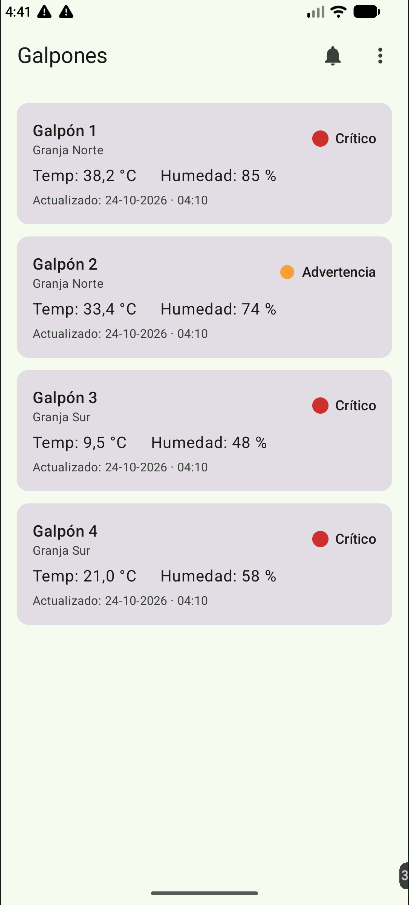
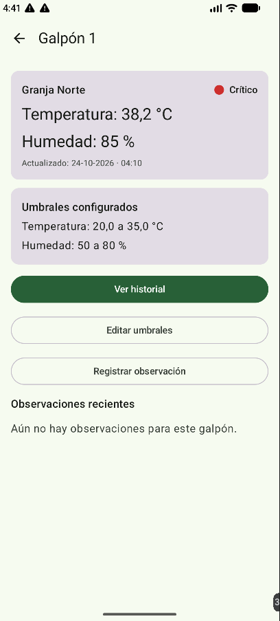
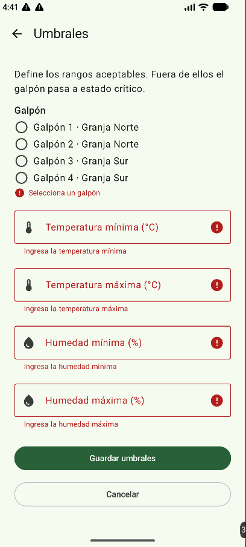
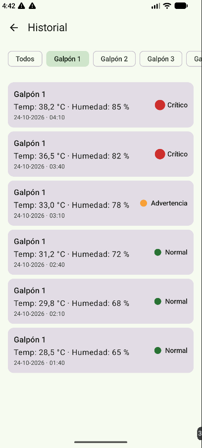
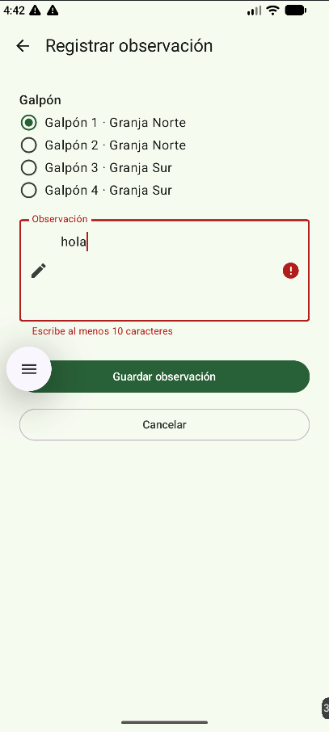
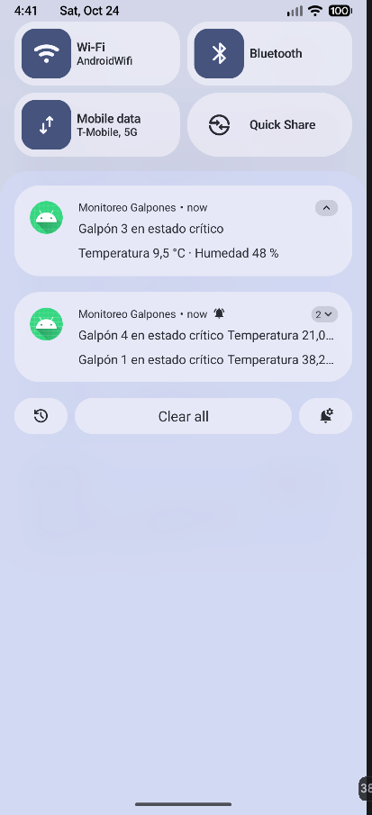

# App Monitoreo de Galpones

App Android para monitorear galpones y gestionar alertas y acciones. Desarrollada en Kotlin con Jetpack Compose y Material 3 para el ramo DSY1105.

## Descripción

La app permite al personal de una granja avícola vigilar la temperatura y la humedad de sus galpones. Cada galpón se muestra con un semáforo (normal, advertencia o crítico) calculado a partir de umbrales configurables. Cuando un galpón pasa a estado crítico, la app envía una notificación y hace vibrar el dispositivo. El personal puede registrar observaciones y acciones, y la jefatura dispone de un resumen de alertas.

Los datos provienen de una API simulada (FakeApi) y se guardan en Room, por lo que sobreviven al cerrar la app y se pueden leer sin conexión.

## Funcionalidades

- **Inicio de sesión** con tres perfiles (operario, supervisor y jefatura) y validación por campo.
- **Inicio**: lista de galpones con su estado, temperatura, humedad y hora de la última medición.
- **Detalle de galpón**: valores actuales, umbrales configurados y últimas observaciones.
- **Historial** de mediciones con filtro por galpón.
- **Umbrales**: formulario para definir la temperatura y la humedad mínima y máxima de cada galpón, con validación de rangos.
- **Registrar observación**: formulario con validación (galpón y descripción de 10 a 200 caracteres).
- **Alertas** activas, **registro de acciones** sobre una alerta y **resumen para jefatura**.
- **Notificación local y vibración** al detectar un galpón en estado crítico (permiso `POST_NOTIFICATIONS`).
- **Estado de red** con aviso de "sin conexión" y lectura desde Room.
- **Animaciones**: transiciones entre pantallas, pulso del semáforo en estado crítico, cambio animado de color del semáforo y retroalimentación en los formularios.

## Capturas

| Inicio | Detalle | Umbrales |
|---|---|---|
|  |  |  |

| Historial | Observación | Notificación |
|---|---|---|
|  |  |  |

## Cómo usar la app

1. **Iniciar sesión.** Escribe el correo y la clave de un usuario de prueba (tabla más abajo) y elige el perfil que corresponde a ese usuario.
2. **Aceptar el permiso de notificaciones** cuando la app lo pida. Sin él no llegan los avisos de estado crítico.
3. **Inicio.** Muestra los galpones con su semáforo: verde (normal), amarillo (advertencia, cerca del límite de los umbrales) y rojo (crítico, fuera de los umbrales). El punto rojo pulsa. Toca un galpón para ver su detalle.
4. **Alertas.** El ícono de campana abre las alertas activas. Al tocar una alerta se abre el formulario para registrar una acción.
5. **Menú de tres puntos** (arriba a la derecha en Inicio):
   - *Historial*: mediciones de todos los galpones; los botones superiores filtran por galpón.
   - *Umbrales*: elige un galpón, ajusta la temperatura y la humedad mínima y máxima, y guarda. Si el valor actual queda fuera del rango, el galpón pasa a crítico y llega una notificación con vibración.
   - *Registrar observación*: elige un galpón y escribe entre 10 y 200 caracteres. La observación aparece luego en el detalle del galpón.
   - *Resumen para jefatura*: solo visible con el perfil de jefatura.
   - *Cerrar sesión*.
6. **Sin conexión.** Si el dispositivo pierde internet aparece un aviso en la parte inferior y la app sigue mostrando los datos guardados en Room.

## Pasos de ejecución

1. Clonar el repositorio:
   ```
   git clone https://github.com/Chente-Git/app-monitoreo-galpones.git
   ```
2. Abrir la carpeta clonada en Android Studio (File > Open).
3. Esperar a que termine la sincronización de Gradle.
4. Crear o elegir un emulador (se probó con Pixel 8) desde Device Manager.
5. Presionar Run (el botón verde de play) para instalar y abrir la app.
6. Iniciar sesión con uno de los usuarios de prueba. El perfil elegido en la pantalla debe coincidir con el rol del usuario.

### Usuarios de prueba

| Rol | Correo | Contraseña |
|---|---|---|
| Operario | operario@galpones.cl | Operario123 |
| Supervisor | supervisor@galpones.cl | Supervisor123 |
| Jefatura | jefatura@galpones.cl | Jefatura123 |

## Estructura de carpetas

Paquete base: `com.duoc.galpones`

```
galpones
├── GalponesApp.kt
├── MainActivity.kt
├── data
│   ├── fakeapi      Datos simulados de alertas, usuarios, galpones y mediciones
│   ├── local        Base de datos Room (AppDatabase, dao, entity)
│   ├── mapper       Conversión entre entidades de Room y modelos de dominio (galpones y alertas)
│   ├── red          MonitorRed: estado de la conexión
│   └── repository   Implementaciones de los repositorios
├── di               AppContainer: inyección de dependencias manual
├── domain           Reglas de negocio y validaciones
│   ├── model        Modelos de dominio
│   ├── repository   Interfaces de los repositorios
│   └── validation   ValidadorLogin, ValidadorAccion, ValidadorUmbrales y ValidadorObservacion
├── platform         Recursos nativos
│   ├── notificaciones   Canal y notificación de estado crítico
│   └── vibracion        Vibración asociada a la notificación
└── ui
    ├── accion       Registro de acciones
    ├── alertas      Lista de alertas
    ├── components   Componentes reutilizables (semáforo, tarjeta de galpón, campos)
    ├── galpones     Inicio, detalle, historial, umbrales y observación
    ├── login        Inicio de sesión
    ├── navigation   AppNavHost y rutas
    ├── permisos     Manejo de permisos
    ├── resumen      Resumen de galpones
    └── theme        Colores, tipografía y tema
```

## Pruebas

Las reglas de validación tienen pruebas unitarias en `app/src/test/java/com/duoc/galpones/domain/validation/`:

- `ValidadorLoginTest`
- `ValidadorAccionTest`
- `ValidadorUmbralesTest`
- `ValidadorObservacionTest`

Para ejecutarlas desde Android Studio: clic derecho sobre la carpeta `test` → *Run Tests*.
Desde la terminal: `./gradlew testDebugUnitTest`.

## Arquitectura

MVVM con AppContainer manual. Las reglas de validación viven en `domain/validation/` (`ValidadorLogin`, `ValidadorAccion`, `ValidadorUmbrales`, `ValidadorObservacion`) y los composables solo muestran el estado que entrega cada ViewModel. La UI lee desde Room; la red solo alimenta la base cuando las tablas están vacías, por lo que la app funciona sin conexión usando los datos ya guardados.
